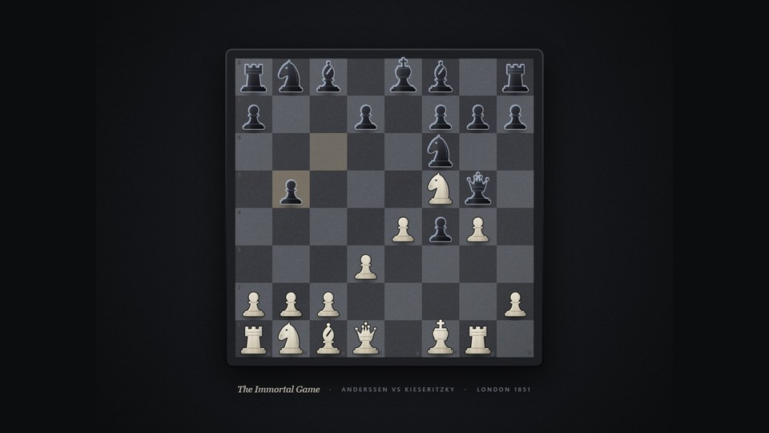
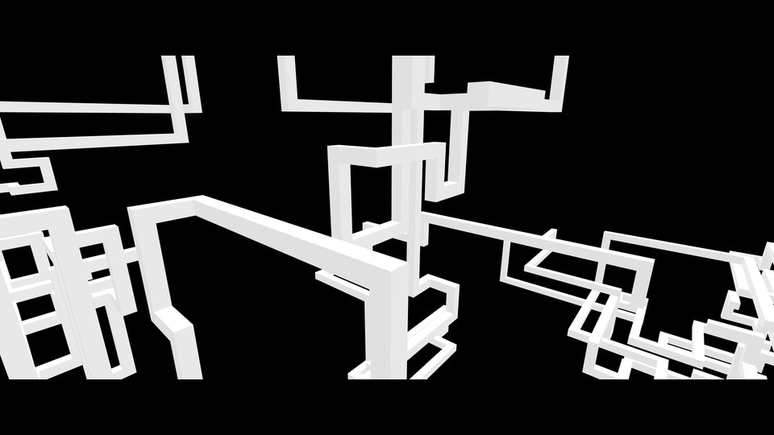

# Lively wallpapers

Live wallpapers for Windows, made for
[Lively Wallpaper](https://github.com/rocksdanister/lively) (free). Each one
is a small web page with no build step, lives in its own repository, and has
its own settings in Lively's **Customize** panel.

| | |
| :---: | :---: |
|  |  |
| **[Star Trails](https://github.com/chayapolsuriyajan-stack/StarWallpaper)** The real night sky turning around the north celestial pole, like a long-exposure photograph: 41,487 catalogue stars, constellations, trail and speed settings. [Download](https://github.com/chayapolsuriyajan-stack/StarWallpaper/releases/latest) | **[Chess](https://github.com/chayapolsuriyajan-stack/chess-wallpaper)** A dark-mode board you can play on: click pieces to play a from-scratch engine, watch bots play, or replay famous games and legends. [Download](https://github.com/chayapolsuriyajan-stack/chess-wallpaper/releases/latest) |
|  |  |
| **[Rubik's Graph](https://github.com/chayapolsuriyajan-stack/rubiks-graph-wallpaper)** A Rubik's Cube scrambles and is genuinely solved, beside the permutation graph of its 54 stickers. Every turn rotates both. [Download](https://github.com/chayapolsuriyajan-stack/rubiks-graph-wallpaper/releases/latest) | **[Wireframe Pipes](https://github.com/chayapolsuriyajan-stack/CustomWallpaper)** Solid white beams grow through black space at right angles, then play themselves backward and begin again. [Download](https://github.com/chayapolsuriyajan-stack/CustomWallpaper/releases/latest) |

## Installing

1. Install [Lively Wallpaper](https://github.com/rocksdanister/lively).
2. Open a wallpaper's **Download** link above and get the `.zip` from its
   latest release.
3. In Lively, choose **Add Wallpaper → Browse** and pick the zip, or drag the
   zip onto the Lively window.
4. Right-click the wallpaper in Lively's library → **Customize** for its
   settings.

## Finding more

Every wallpaper here is tagged
[`lively-wallpaper`](https://github.com/search?q=user%3Achayapolsuriyajan-stack+topic%3Alively-wallpaper&type=repositories).
